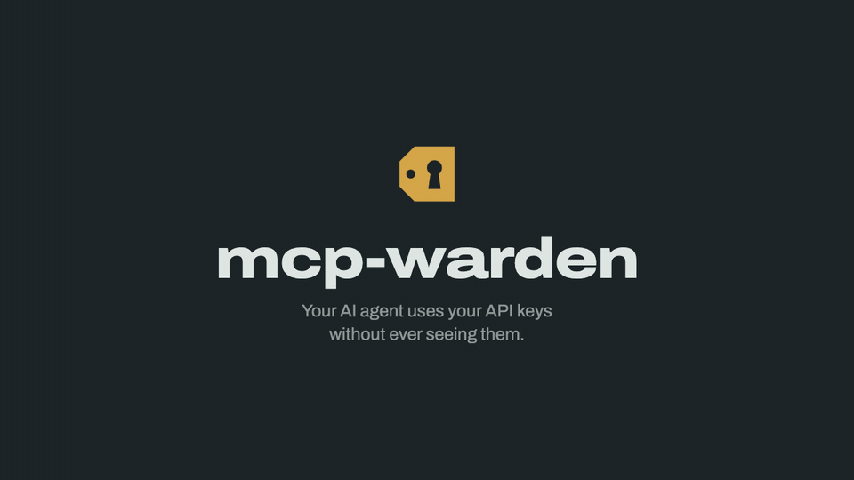

# mcp-warden

> A local-first credential broker for the Model Context Protocol — lets any AI coding agent (Claude Code, Cursor, Cline, Codex, Continue, Zed) take real actions without ever seeing your secrets.

The agent calls high-level tools (`proxy_http`); `mcp-warden` injects the secret server-side, executes the action, and returns only the result. Your context window stays clean. A leaked transcript leaks nothing useful.

[](https://github.com/ermoluk/mcp-warden/actions/workflows/ci.yml)
[](https://crates.io/crates/mcp-warden)
[](https://opensource.org/licenses/Apache-2.0)



## How it works

1. You store a credential once in the OS keychain via the `mcp-warden` CLI.
2. You define **presets** — named, scoped actions (e.g. `github-read`, `stripe-charges`).
3. The AI agent connects to `mcp-warden` as an MCP server (stdio).
4. When the agent wants to act, it calls `proxy_http` with a preset name and a path/method.
5. `mcp-warden` validates the request against the preset's allow-list, injects the credential, executes, and returns only the response.
6. Sensitive presets trigger an approval prompt: a native dialog on macOS, a desktop notification with Approve / Deny on Linux, or a Telegram message on any OS (the option for Windows). Opt in to **time-boxed approvals** per preset so one OK can cover a short burst of follow-up calls without re-prompt spam.
7. Every action lands in a local SQLite audit log — including a `windowed` decision for calls authorised by an active approval window, a `refused` decision (with the raw requested path or command) for calls the allow-list turned away, and a `failed` decision when the approval prompt could not be shown.

The agent's context window contains zero secrets.

## Install

```bash
cargo install mcp-warden          # from crates.io
cargo install --path .            # or from a clone
```

Pre-built binaries for macOS (x86_64, aarch64) and Linux (x86_64), each with a SHA-256 checksum, are attached to every [GitHub release](https://github.com/ermoluk/mcp-warden/releases).

## 90-second quickstart

```bash
mcp-warden init
mcp-warden secret add gh_pat                  # paste your GitHub PAT when prompted
mcp-warden preset add github-read \
  --type http \
  --base-url https://api.github.com \
  --auth-bearer gh_pat \
  --allowed-methods GET \
  --allowed-paths /user/repos \
  --approval auto --confirm-auto
```

The preset auto-approves only `GET /user/repos`; any other path is refused before the token is touched. To let the agent read more, widen the allow-list (e.g. `--allowed-paths '/user/repos,/repos/OWNER/[^/]+'`) and prefer a fine-grained PAT limited to specific repos. Patterns match the whole path, as exact strings or regexes anchored as `^(?:…)$`, never as prefixes; `[^/]+` is safer than `.*` for one segment. They see the percent-decoded path, so `%2F` is a separator: a GitLab-style id like `/projects/group%2Fproject` needs `/projects/[^/]+/[^/]+`. An HTTP preset with no `allowed_paths` allows every path under `base_url` — `preset add` and `doctor` warn about it, and the built-in `github-read` / `gitea-read` / `stripe-read` templates ship with `approval = "prompt"` for that reason.

Wire `mcp-warden` into your agent — see [`docs/claude-code-setup.md`](docs/claude-code-setup.md) or [`docs/cursor-setup.md`](docs/cursor-setup.md).

In your agent: ask "list my GitHub repos via mcp-warden". Watch the agent call `list_presets`, then `proxy_http` — and watch your PAT stay out of the prompt.

```bash
mcp-warden audit --last 5                     # see what the agent did
```

## CLI reference

| Command                                    | Description                                              |
|--------------------------------------------|----------------------------------------------------------|
| `mcp-warden init`                          | Create the config directory and a template config        |
| `mcp-warden secret add <name>`             | Store a secret (value read from stdin, never argv)       |
| `mcp-warden secret list`                   | List secret names (never values)                         |
| `mcp-warden secret remove <name>`          | Delete a secret from the keychain                        |
| `mcp-warden preset add <name> ...`         | Define a preset (`--confirm-auto` required for `auto`)   |
| `mcp-warden preset list`                   | Show all presets                                         |
| `mcp-warden preset test <name>`            | Validate a preset against the current keychain           |
| `mcp-warden preset scaffold <template>` *(v0.3.0)* | Generate a preset from a built-in template (`--list` to discover) |
| `mcp-warden preset from-openapi <src>` *(v0.3.0)* | Bootstrap a preset from an OpenAPI 3.x spec (URL or file) |
| `mcp-warden approval <preset> <policy> [--window N]` | Set approval policy; `--window N` (sec) enables time-boxed approvals for `prompt` |
| `mcp-warden audit [--last N \| --since T]` | Read-only view of the audit log (append-only by design), with what the agent asked for — including refused calls |
| `mcp-warden doctor [--deep]` *(v0.3.0 for `--deep`)* | Diagnostic summary; `--deep` runs safe read-only HTTP probes per preset |
| `mcp-warden web [--port N]` *(v0.3.0)*     | Local read-only web UI (binds 127.0.0.1 only)            |
| `mcp-warden mcp`                           | Run the MCP server over stdio (consumed by the AI agent) |

## MCP tools exposed

- **`list_presets`** — read-only catalogue of available actions.
- **`proxy_http`** — execute an HTTP request through a preset; allow-list validation runs before credential injection.
- **`ssh_exec`** *(v0.2.0)* — run a shell command on an SSH host; command must match preset's anchored regex allow-list; key-based auth + host-key verification.
- **`sftp_transfer`** *(v0.2.0)* — get/put a file over SFTP; remote path matches preset's `sftp_allowed_paths`, local path under `$HOME` or `/tmp`.
- **`db_query`** *(v0.2.0)* — run a NAMED QUERY against PostgreSQL / MySQL / Redis. SQL/command is fixed at preset definition; agent supplies only `query_name` + positional params.
- **`get_secret_for_env`** — last-resort tool when a child process must read a secret from `env`. Always prompts for approval, regardless of preset policy.

## Claude Code plugin

For [Claude Code](https://claude.com/claude-code) there is a plugin that bundles the MCP server config, a skill that teaches Claude to use mcp-warden correctly (discover presets first, never ask for tokens, respect approvals, treat `get_secret_for_env` as a last resort) and a guided `/mcp-warden:setup` command. Install the binary first, then in Claude Code:

```
/plugin marketplace add ermoluk/mcp-warden
/plugin install mcp-warden@mcp-warden
```

Restart Claude Code and run `/mcp-warden:setup`. If you previously added the server with `claude mcp add`, remove that entry so it isn't registered twice. Details: [`plugins/mcp-warden/`](plugins/mcp-warden/).

Other MCP clients: see [`docs/claude-code-setup.md`](docs/claude-code-setup.md) and [`docs/cursor-setup.md`](docs/cursor-setup.md) for manual setup.

## What's new in v0.4.0

- **Workspace split.** The project is now two crates: `mcp-warden-core` (library — trait surfaces + shared types) and `mcp-warden` (binary — CLI, MCP server, executor, web UI, concrete approval transports). Alternate implementations of `KeychainStore`, `ApprovalTransport`, `AuditSink`, or `PresetSource` now depend only on `mcp-warden-core` and don't drag the binary's GUI/runtime stack.
- **Telegram approval transport wired in.** The impl already existed in v0.3.0; v0.4.0 makes it actually selectable. Add to your config file (`mcp-warden doctor` prints its path: `~/.config/mcp-warden/` on Linux, `~/Library/Application Support/io.mcp-warden.mcp-warden/` on macOS):
  ```toml
  [approval.telegram]
  bot_token_secret = "tg_bot_token"   # name of the keychain entry, not the token value
  chat_id = 123456789                  # your numeric Telegram chat id
  timeout_seconds = 120                # optional
  ```
  then `mcp-warden secret add tg_bot_token` (pastes the bot token into the keychain). `prompt`-policy presets now send Approve / Deny inline-button messages to that chat; if the Telegram prompt times out, macOS asks again in the native dialog (see [`docs/approval-transports.md`](docs/approval-transports.md)). Override at runtime with `MCP_WARDEN_APPROVAL_TRANSPORT={telegram|desktop|tui}`.

## What's new in v0.3.0

- **`preset scaffold`** — 8 built-in templates for the most common APIs (`github-read`, `github-write`, `notion-read`, `stripe-read`, `openai-chat`, `anthropic-messages`, `gitea-read`, `cloudflare-dns`). Generate a working preset in one command instead of copy-pasting from the cookbook.
- **`preset from-openapi <url-or-file>`** — point it at an OpenAPI 3.0/3.1 JSON or YAML spec and it derives `base_url`, `allowed_paths`, `allowed_methods`, and the auth scheme (Bearer or APIKey-Header). Filter by HTTP method or tag.
- **`doctor --deep`** — for each HTTP preset, runs a safe read-only probe (GET against base URL or first literal allowed path), reports ok / auth_failed / auth_ok_404 / network_error / tls_error / skipped, with elapsed time and a redacted body snippet. Skips `prompt`-policy presets unless `--include-prompt` is passed.
- **`web`** — a small local-only web UI (binds `127.0.0.1`, hardcoded) for browsing presets and the audit log without spawning a TUI. Read-only in this release; approval over WebSocket is on the roadmap.
- **Telegram approval transport** — new `ApprovalTransport` impl that sends approval prompts to a Telegram chat with inline Approve / Deny / Approve-for-window buttons. Bot token lives in the OS keychain. Foreign-chat callbacks are rejected. Message uses `protect_content: true`. Selected automatically when `[approval.telegram]` is configured.

See `docs/web-ui.md` for the web UI design notes.

## Security model

`mcp-warden`'s threat model and security invariants live in [`docs/threat-model.md`](docs/threat-model.md). At a glance:

- Secrets in the OS keychain only — never on disk in plaintext, never in logs.
- Allow-list validation runs **before** credential injection.
- Default approval policy is `prompt`; `auto` requires `--confirm-auto` at preset creation.
- The MCP server loads and validates `config.toml` once at startup and never re-reads it: restart the server after editing presets.
- Audit log is append-only — the trait surface itself contains no `delete` / `clear` method.
- Stdout is the MCP protocol channel; all logs go to stderr.

## Links

- crates.io: [`mcp-warden`](https://crates.io/crates/mcp-warden)
- MCP Registry name: `mcp-name: io.github.ermoluk/mcp-warden`

## License

Apache-2.0 — permanent commitment for the OSS core. See [LICENSE](LICENSE).

mcp-warden stays fully functional for free, forever — see our [open-core commitment](docs/open-core.md).
